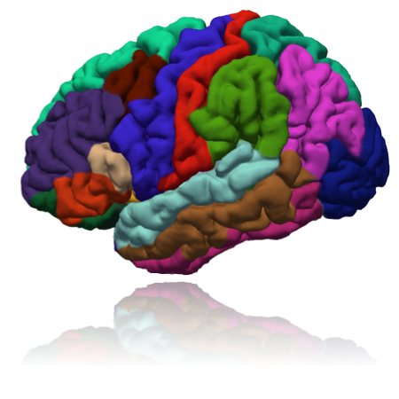

<p align="center">
  
</p>

<h1 align="center">FreeSurfer recon-all</h1>

<p align="center">
  Cortical surfaces, a whole-brain segmentation and three anatomical parcellations from a single T1-weighted image.
</p>

<p align="center">
  <a href="https://doi.org/10.25663/brainlife.app.664"></a>
  <a href="https://doi.org/10.25663/brainlife.app.664"></a>
  <a href="https://github.com/brainlife/abcd-spec"></a>
  <a href="https://surfer.nmr.mgh.harvard.edu/"></a>
  <a href="LICENSE"></a>
</p>

## At a glance

<!-- brainlife-app:begin (generated from the App manifest; edit the manifest, not this block) -->

**Runs FreeSurfer 7.3.2 recon-all on a T1-weighted image (optionally with a T2w for the pial surface) to produce cortical surfaces, a volumetric segmentation and the Desikan-Killiany, Destrieux and DKT parcellations.**

Wraps FreeSurfer's recon-all -all (one or more T1w images). Use it as the first step for any analysis that needs cortical surfaces, cortical thickness or an anatomical parcellation (for example as ROIs for tractography or network analysis). An optional T2-weighted image refines the pial surface; optional steps run hippocampal subfield (segmentHA_T1/T2) and thalamic nuclei segmentation and local gyrification index. Expect many hours of compute per subject; the input should be a whole-head T1w image roughly aligned to the anatomical axes.

Run it on brainlife.io: [https://doi.org/10.25663/brainlife.app.664](https://doi.org/10.25663/brainlife.app.664)

| Input | Datatype | Required | Description |
|---|---|---|---|
| `t1` | `neuro/anat/t1w` | yes | t1 to input |
| `t2` | `neuro/anat/t2w` | no | Using T2 to improve pial surfaces |

| Output | Datatype | Description |
|---|---|---|
| `freesurfer` | `neuro/freesurfer` | The FreeSurfer subject directory (mri, surf, label, stats, scripts). |
| `parc` | `neuro/parcellation/volume` | Desikan-Killiany (aparc+aseg) volumetric parcellation in NIfTI. |
| `parc2009` | `neuro/parcellation/volume` | Destrieux (aparc.a2009s+aseg) volumetric parcellation in NIfTI. |
| `parcDKT` | `neuro/parcellation/volume` | DKT (aparc.DKTatlas+aseg) volumetric parcellation in NIfTI. |

| Parameter | Type | Default | Description |
|---|---|---|---|
| `hires` | boolean | `false` | Check this flag if your input t1 has voxel sizes less than 1mm3 (submillimeter resolution) like HCP 7T. (HCP 3T is 1.25mm). The processing will take a significantly longer time. See https://surfer.nmr.mgh.harvard.edu/fswiki/SubmillimeterRecon |
| `notalcheck` | boolean | `false` | If you are seeing "ERROR: Talairach failed", you might be able to work around this by setting this option so that freesurfer will skip this process. If you set this option, you will need to make sure that your image is well aligned to the 3 primary axis. |
| `cw256` | boolean | `false` | If a scan has a field-of-view (FOV) greater than 256, check this to force the FOV to 256. You often need to do this for an image with sub 1mm voxel size (like HCP 7T) |
| `debug` | boolean | `false` | Turn on copious amount of freesurfer log |
| `expert` | string |  | You can specify extra command line options for various freesurfer commands executed by recon-all. Please leave it blank unless necessary. https://surfer.nmr.mgh.harvard.edu/fswiki/recon-all#ExpertOptionsFile |
| `hippocampal` | boolean | `false` | Generate an automated segmentation of the hippocampal subfields based on a statistical atlas built primarily upon ultra-high resolution (~0.1 mm isotropic) ex vivo MRI data. This new method can take advantage high-resolution, dedicated images when available (typically, but not necessarily, T2 weighted), and solves a number of limitations of the in vivo atlas that was distributed with FreeSurfer 5.1-5.3, namely |
| `thalamicnuclei` | boolean | `false` | (For freesurfer >7) Generate a parcellation of the thalamus into 25 different nuclei, using a probabilistic atlas built with histological data. The parcellation is based on structural MRI, either the main T1 scan processed through recon-all, or an additional scan of a different modality, which potentially shows better contrast between the nuclei. [http://freesurfer.net/fswiki/ThalamicNuclei] |
| ` localGI` | boolean | `false` | local Gyrification Index (lGI) This will produce files named lh.pial_lgi and rh.pial_lgi in the subjects surf directory. These files can be loaded as overlays in tksurfer. See https://surfer.nmr.mgh.harvard.edu/fswiki/LGI |

Runtime: container `brainlife/freesurfer:7.3.2`; 8 CPUs; 25 GB memory; 18 h walltime; needs `FREESURFER_LICENSE`.

<!-- brainlife-app:end -->

## Versions on brainlife.io

Each version is a separate App on brainlife.io, built from its own branch of this repository.

| Version | FreeSurfer | Branch | Run it | Status |
|---|---|---|---|---|
| Freesurfer 7.3.2 | 7.3.2 | [`7.3.2`](https://github.com/brainlife/app-freesurfer/tree/7.3.2) | [doi:10.25663/brainlife.app.664](https://doi.org/10.25663/brainlife.app.664) | current |
| Freesurfer 7.1.1 | 7.1.1 | [`7.1.1-1`](https://github.com/brainlife/app-freesurfer/tree/7.1.1-1) | [doi:10.25663/brainlife.app.462](https://doi.org/10.25663/brainlife.app.462) | available |
| Freesurfer | 6.0–7.1 (selectable) | [`1.12`](https://github.com/brainlife/app-freesurfer/tree/1.12) | [doi:10.25663/bl.app.0](https://doi.org/10.25663/bl.app.0) | deprecated |

## Running the App

### On brainlife.io

Open the App at [doi.org/10.25663/brainlife.app.664](https://doi.org/10.25663/brainlife.app.664), choose a T1-weighted dataset (and optionally a T2-weighted one) from your project, set the options and press **Execute**. The outputs are archived to your project and can feed any App that takes a `neuro/freesurfer` or `neuro/parcellation/volume` input.

### Locally

You need [Singularity/Apptainer](https://apptainer.org/), [`jq`](https://jqlang.github.io/jq/) and a [FreeSurfer license](https://surfer.nmr.mgh.harvard.edu/registration.html).

1. Clone this repository and check out the version you want (for example `git checkout 7.3.2`).
2. Create `config.json` with the paths to your inputs and the options you want:

   ```json
   {
       "t1": "/input/t1/t1.nii.gz",
       "hippocampal": false,
       "hires": false,
       "notalcheck": false,
       "localGI": false
   }
   ```

3. Export your license and run the App:

   ```bash
   export FREESURFER_LICENSE="$(cat ~/freesurfer/license.txt)"
   ./main
   ```

### Sample data

Download a T1-weighted sample from brainlife.io with the [brainlife CLI](https://github.com/brainlife/cli):

```bash
npm install -g brainlife
bl login
bl dataset download 5a050966eec2b300611abff2 && mv 5a050966eec2b300611abff2 input/t1
```

## Outputs

`output/` is a standard FreeSurfer subject directory:

```text
output/
├── label/     cortical labels and annotations (aparc, aparc.a2009s, aparc.DKTatlas)
├── mri/       volumes: T1, brainmask, aseg, aparc+aseg, …
├── scripts/   recon-all logs
├── stats/     aseg.stats, lh/rh.aparc.stats, …
└── surf/      white, pial, inflated and sphere surfaces
```

The App also writes the Desikan-Killiany (`parc`), Destrieux (`parc2009`) and DKT (`parcDKT`) volumetric parcellations as separate datasets.

## Troubleshooting

- **`ERROR: Talairach failed`**: set `notalcheck` to skip the Talairach check, and make sure the image is roughly aligned to the anatomical axes (the ACPC alignment Apps on brainlife.io can do this).
- **Submillimetre or HCP 7T data**: set `hires`, and `cw256` if the field of view is larger than 256 mm. Expect a much longer run.

## Citing

If you use this App, please cite FreeSurfer and brainlife.io:

- Fischl B. FreeSurfer. *NeuroImage* 62(2):774–781 (2012). [doi:10.1016/j.neuroimage.2012.01.021](https://doi.org/10.1016/j.neuroimage.2012.01.021)
- Hayashi S, Caron BA, Heinsfeld AS, et al. brainlife.io: a decentralized and open-source cloud platform to support neuroscience research. *Nature Methods* 21:809–813 (2024). [doi:10.1038/s41592-024-02237-2](https://doi.org/10.1038/s41592-024-02237-2)
- Avesani P, McPherson B, Hayashi S, et al. The open diffusion data derivatives, brain data upcycling via integrated publishing of derivatives and reproducible open cloud services. *Scientific Data* 6:69 (2019). [doi:10.1038/s41597-019-0073-y](https://doi.org/10.1038/s41597-019-0073-y)

## Authors

- Franco Pestilli (project director)
- Lindsey Kitchell

**Contributors:** Soichi Hayashi, Brent McPherson

## Funding

brainlife.io is publicly funded, and acknowledging that support helps keep it running. This App was developed with support from Wellcome (226486/Z/22/Z); the U.S. National Institutes of Health through the BRAIN Initiative BRAIN CONNECTS program (NINDS U24NS140384, The Axonal Projectome EXchange (APEX), and NINDS UM1NS132207, Center for Mesoscale Connectomics) and NIBIB R01EB029272 and R01EB030896, NIMH R01MH126699 and NIDCD R01DC020088; and the U.S. National Science Foundation (awards [1734853](https://www.nsf.gov/awardsearch/showAward?AWD_ID=1734853), [1636893](https://www.nsf.gov/awardsearch/showAward?AWD_ID=1636893), [1916518](https://www.nsf.gov/awardsearch/showAward?AWD_ID=1916518), [1912270](https://www.nsf.gov/awardsearch/showAward?AWD_ID=1912270), [2148729](https://www.nsf.gov/awardsearch/showAward?AWD_ID=2148729), [2148700](https://www.nsf.gov/awardsearch/showAward?AWD_ID=2148700) and [2203524](https://www.nsf.gov/awardsearch/showAward?AWD_ID=2203524)).

## License

[MIT](LICENSE). FreeSurfer itself is distributed under its own [license](https://surfer.nmr.mgh.harvard.edu/fswiki/FreeSurferSoftwareLicense).
